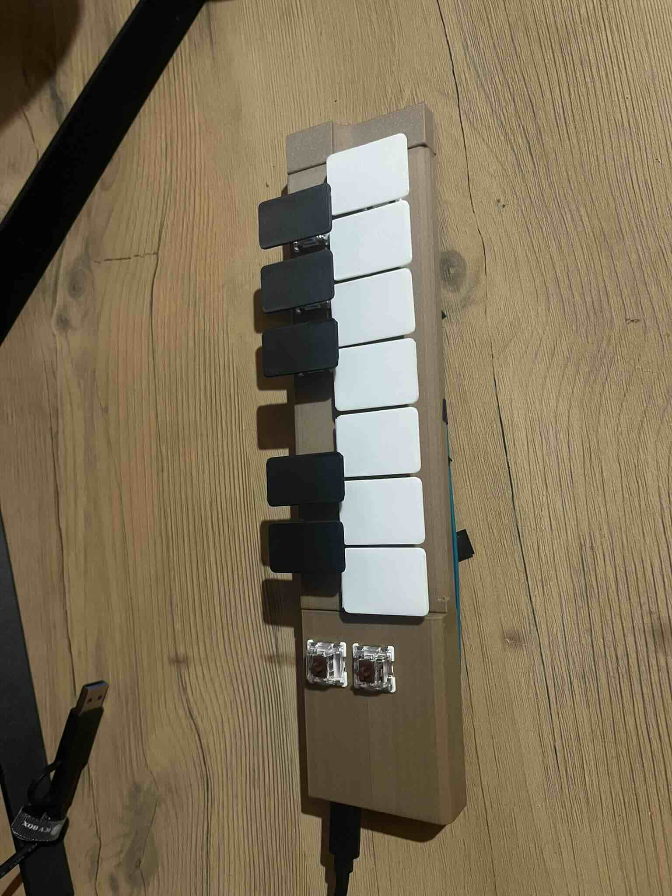
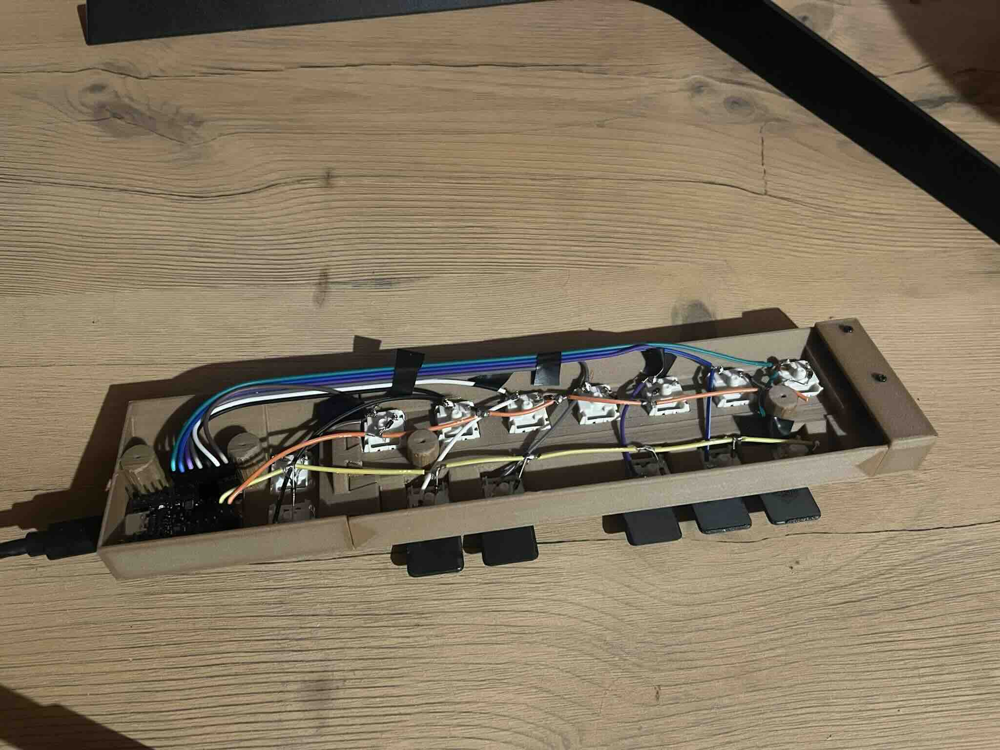
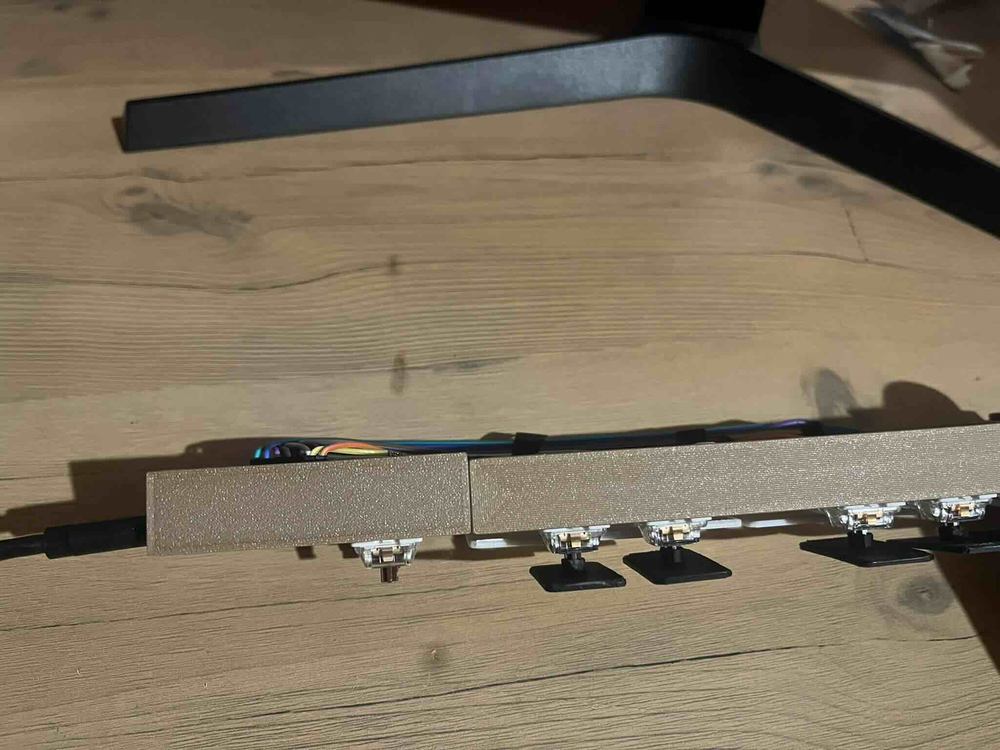

## 2026-11-16

### Code changes

Inspired by (video)[https://youtu.be/KBkqJZ9JPc8?t=698], I added parameter to cut the corners of connector.
It can be turned off, I didn't test it yet.

Unfortunately, OpenSCAD is heavily limited, in comparison to tool like build123d, which I would probably use
for all my future projects. Due to that, proper chamfering and filleting is really a lot of hustle to do.
Current implementation cut out *N* mms from each corner of the trapezoid, without any rounding. The parameter
can be found at `default.conf.yaml->connector_dims->cut_off_corners_mm`. It ain't much but it honest work!

`cut_off_corners_mm` set to None or <0:

`cut_off_corners_mm` set to 1:

`cut_off_corners_mm` set to 2:

### Hardware progress

Also, I've successfully built first prototype, using NRF52840 cheap, chinese nice nano clone, and built software
for it, using ZMK. I've only got this microcontroller on my hand, but the final version I would love to build
using arduino pro micro or RPi Pico and QMK Firmware, due to lack of the support for MIDI signals in ZMK.

I've got really valueable informations thanks to this prototype, next (I hope final 🙏) version have to be a
bit taller, to accomodate space for goldpin connectors.