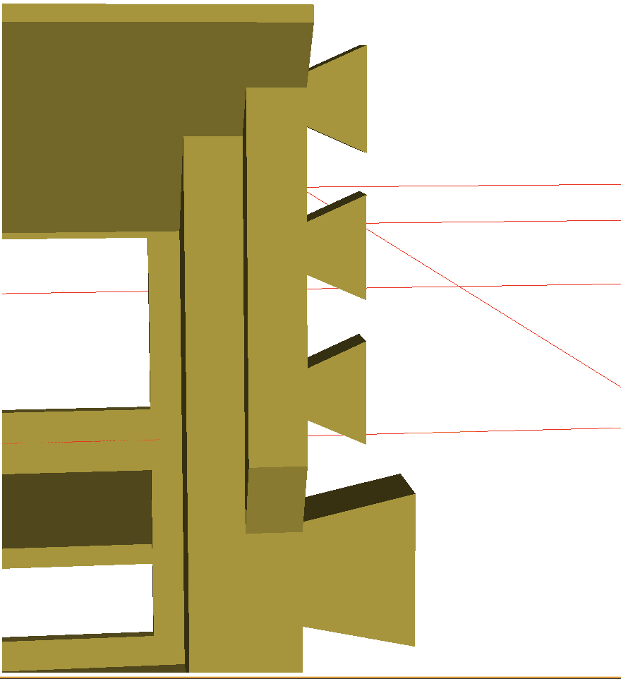
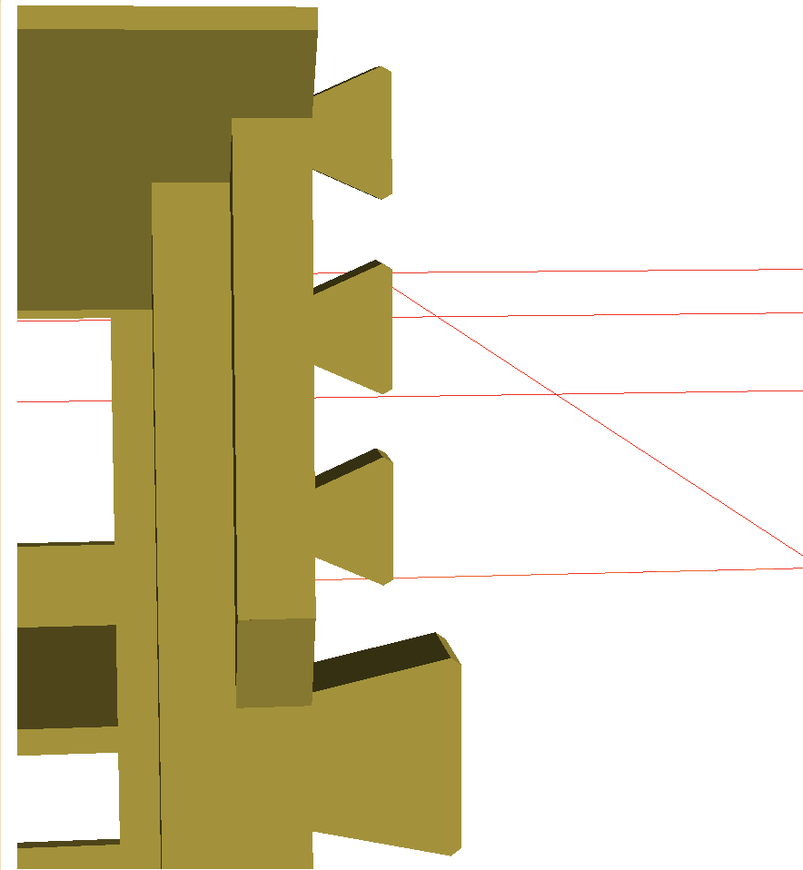
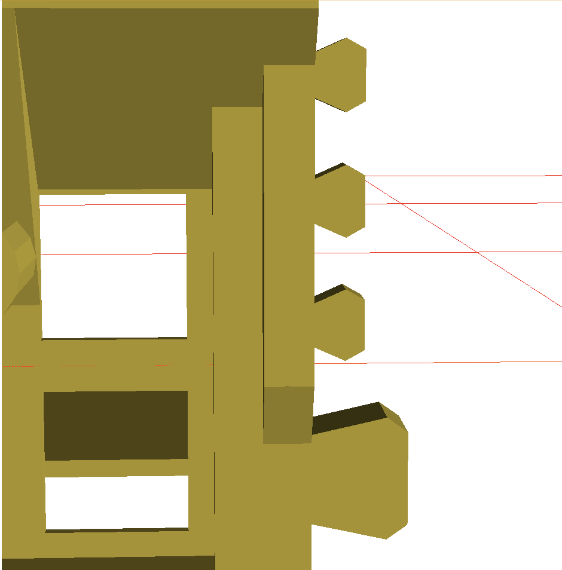
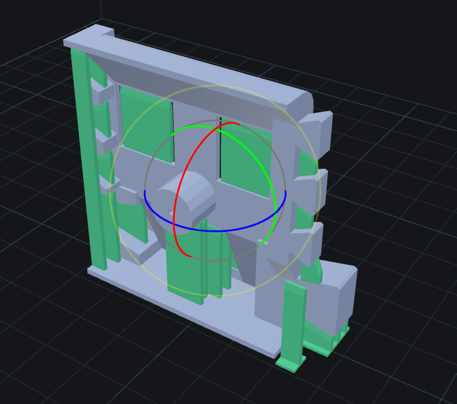
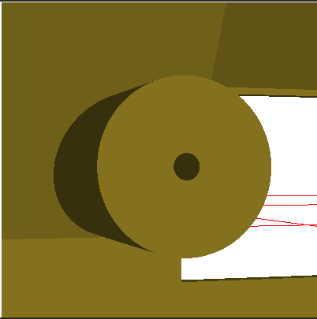
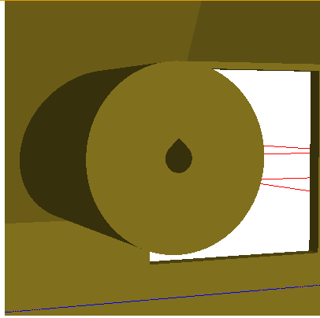

## 2026-11-16

### Code changes

Inspired by [video](https://youtu.be/KBkqJZ9JPc8?t=698), I added parameter to cut the corners of connector.
It can be turned off, I didn't test it yet.

Unfortunately, OpenSCAD is heavily limited, compared to tool like build123d, which I would probably use
for all my future projects. Due to that, proper chamfering and filleting is really a lot of hustle to do.
Current implementation cut out *N* mms from each corner of the trapezoid, without any rounding. The parameter
can be found at `default.conf.yaml->connector_dims->cut_off_corners_mm`. It ain't much but it honest work!

`cut_off_corners_mm` set to None or <0:


`cut_off_corners_mm` set to 1:


`cut_off_corners_mm` set to 2:



### Hardware progress

Also, I've successfully built first prototype, using NRF52840 cheap, chinese nice nano clone, and built software
for it, using ZMK. I've only got this microcontroller on my hand, but the final version I would love to build
using arduino pro micro or RPi Pico and QMK Firmware, due to lack of the support for MIDI signals in ZMK.


I've got really valueable informations thanks to this prototype, next (I hope final 🙏) version have to be a
bit taller, to accomodate space for goldpin connectors.


## 2026-11-17

Today, I tested how [printfins](https://printfins.com/) could be used for this project
as a support structure. Manually, using webpage and setting up placement to `Full Coverage`
I've got really good results, with one small error - one support fin which doesn't support
any part of the model (right down corner of the image below).



I've tested the CLI version, it is served as node module, and do the same model as
the webpage one. It could be successfully used as a part of building model pipeline.

Command:
```bash
node support-fins.mjs build/partial_octave.stl --mode full
```

### TODO

- [ ] Print one model using fins rather than classical supports
- [X] Report bug to the author

## 2026-11-22

I've added parameter to control number of segments, for round objects, thanks to [stack overflow post](https://stackoverflow.com/questions/54073851/how-to-set-special-variables-fa-fs-fn-in-solidpython).


Before:


After:


Slicer shows the same time to build part, no matter how many segments do we use. Generator runs
a bit longer, for some models even 150% of previous time, but I think it's worth
the effort.


## 2026-11-23

Added configurable teardrop shape for screw holes.

Teardrop off:



Teardrop on:



It should be beneficial for screwing backplate using screw directly to the hole.
Probably it should be turned off for heat inserts.